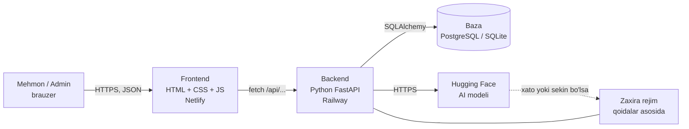
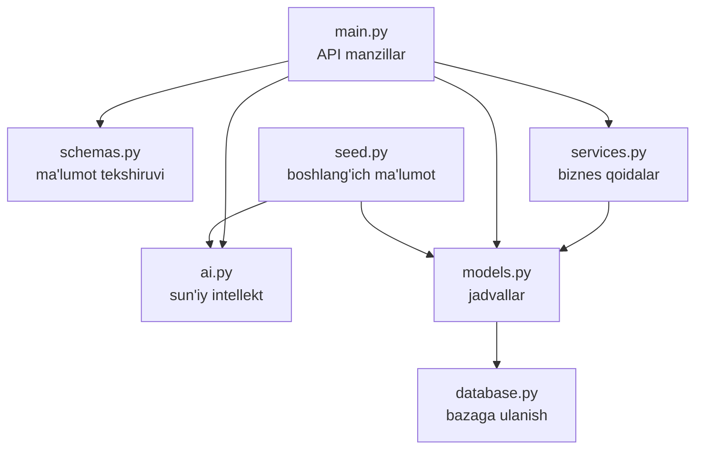
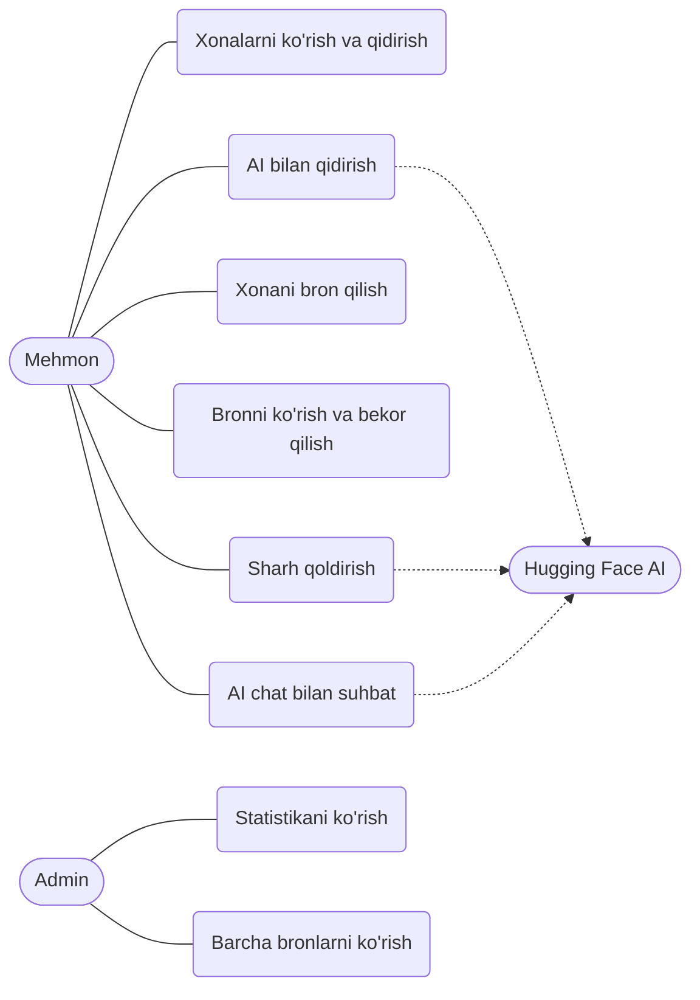
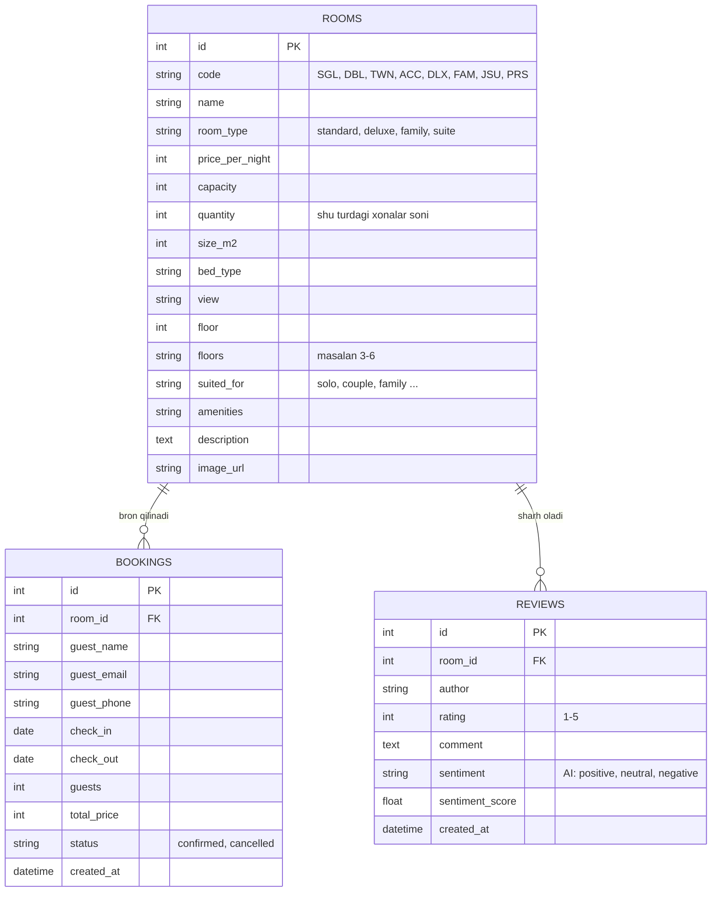
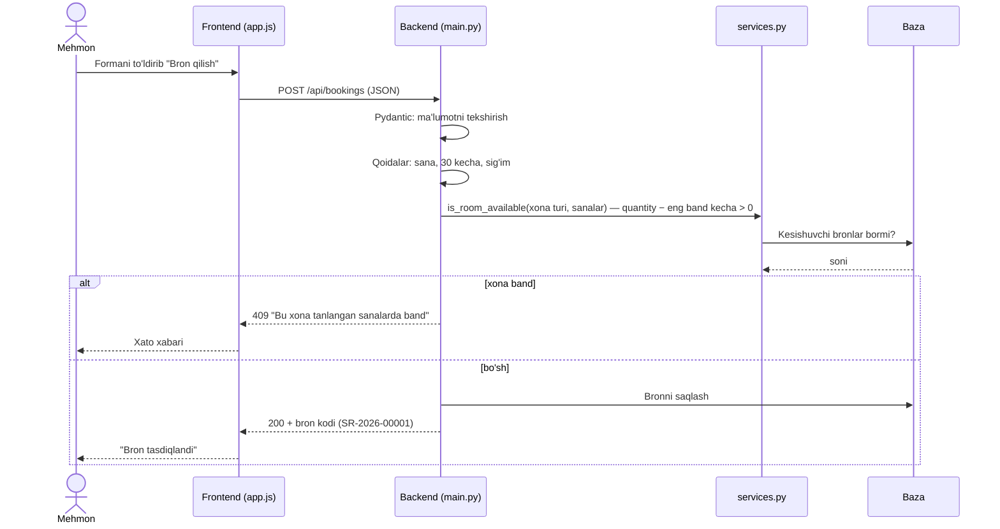
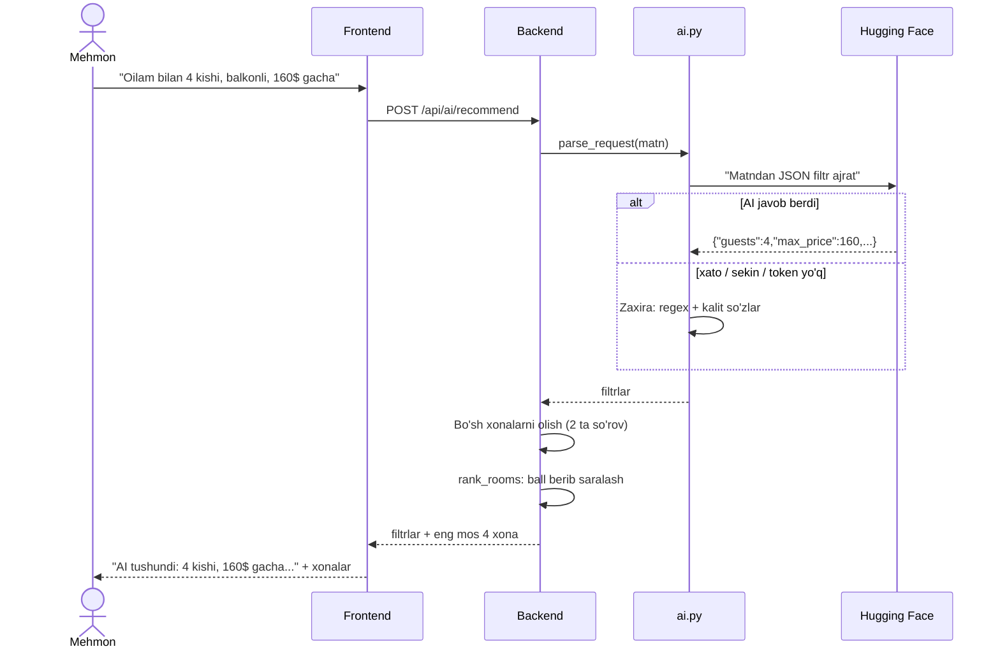

# 2. Loyihalash (arxitektura va diagrammalar)

Diagrammalar **Mermaid** formatida. GitHub'da avtomatik chizma bo'lib ko'rinadi; PyCharm'da Mermaid plagini yoki https://mermaid.live saytida ochish mumkin.

## 2.1. Umumiy arxitektura (3 qatlamli)

**Qatlamlar:**
1. **Taqdimot qatlami** — `frontend/` (ko'rinish va foydalanuvchi bilan muloqot)
2. **Mantiq qatlami** — `backend/` (qoidalar, AI)
3. **Ma'lumot qatlami** — baza (jadvallar)

## 2.2. Backend modullari (har fayl bitta vazifa)

## 2.3. Use-case diagrammasi (foydalanish holatlari)

## 2.4. ER diagramma (baza tuzilishi)

**Indekslar** (qidiruvni tezlashtirish uchun): `bookings(room_id, check_in, check_out)`, `bookings(guest_email)`, `reviews(room_id)`.

## 2.5. Ketma-ketlik diagrammasi: bron qilish

## 2.6. AI qidiruv oqimi

## 2.7. Loyihalash qarorlari va sabablari
| Qaror | Sabab |
|---|---|
| Frontend va backend alohida | Har biri alohida joylanadi va rivojlanadi; Netlify/Railway'ga mos |
| FastAPI | Python'da yoziladi, avtomatik hujjat (`/docs`) va ma'lumot tekshiruvi bor |
| SQLAlchemy ORM | SQLite ↔ PostgreSQL ni kodni o'zgartirmasdan almashtirish mumkin |
| `services.py` ajratilgan | Qoidalarni API'dan alohida sinash va tushuntirish oson |
| AI + zaxira rejim | AI tashqi xizmat, uning uzilishi tizimni to'xtatmasligi kerak |
| AI'ga bazadagi xonalar ro'yxati beriladi | AI o'zidan narx/xona to'qib chiqarmasligi uchun |
